# Quipster screenshots

Captured from a live instance at 1920×1080. The condensed gallery lives in the
[README](README.md#screenshots); this page walks through every screen (and feature close-ups)
in more detail. All images live under `docs/screenshots/`. Inline screenshots are downsized
WebP previews — click one to open the full-resolution PNG.

## Home page

[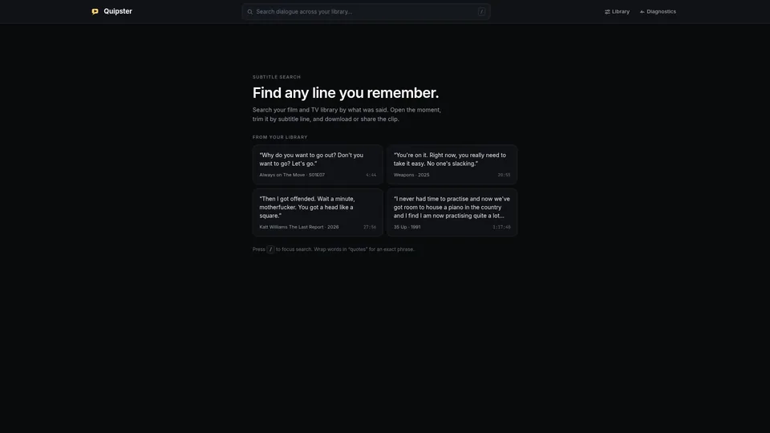](docs/screenshots/home.png)

The landing view doubles as a search launcher: example dialogue quotes are pulled live from the
indexed library, `/` focuses the search box, and wrapping words in `"quotes"` matches an exact
phrase. The header links jump straight into the admin console.

## Search results

[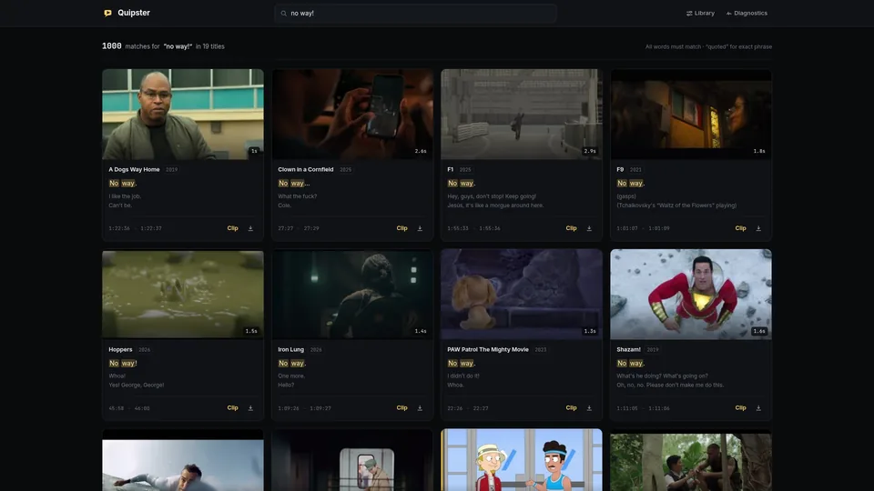](docs/screenshots/search_results.png)

A query for `"no way!"` matches 1,000 subtitle chunks across 19 titles. Results are subtitle
*chunks* (a few merged lines), not raw files: each card shows the frame thumbnail with clip
duration, show title plus season/episode or year, the matched line with highlighted terms, the
surrounding context lines, exact timecodes, and inline **Clip** / download actions. A
"Matches by title" strip groups hits per title below the grid, and pagination carries the rest.

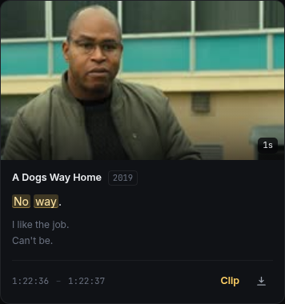

Close-up of one hit: highlighted match, context lines, timecodes, and the Clip/download actions.

## Clip studio

[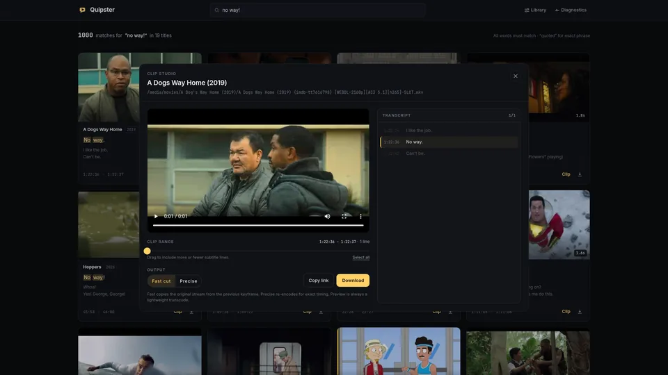](docs/screenshots/clip_modal.png)

Clicking any hit opens the clip studio on that exact moment. The left column holds an in-browser
preview player of the cut; the right column holds the transcript around the hit with the matched
line pre-selected. Below the player, the clip-range trimmer ("drag to include more or fewer
subtitle lines", with **Select all**) sets which lines are included, then the output section
offers **Fast cut** (lossless stream-copy from the previous keyframe) versus **Precise**
(frame-exact re-encode), plus **Copy link** and **Download**.

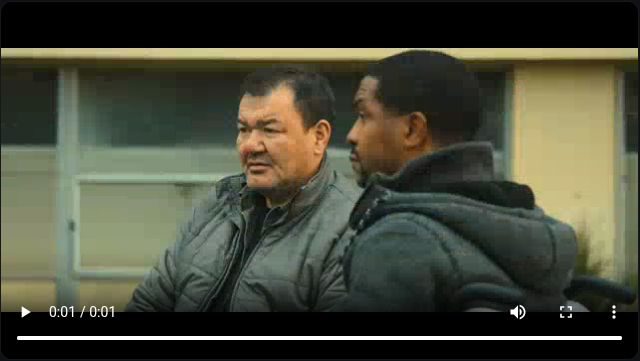

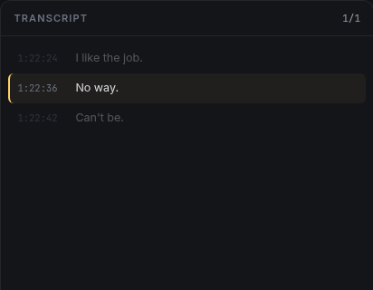

## Admin · Library

[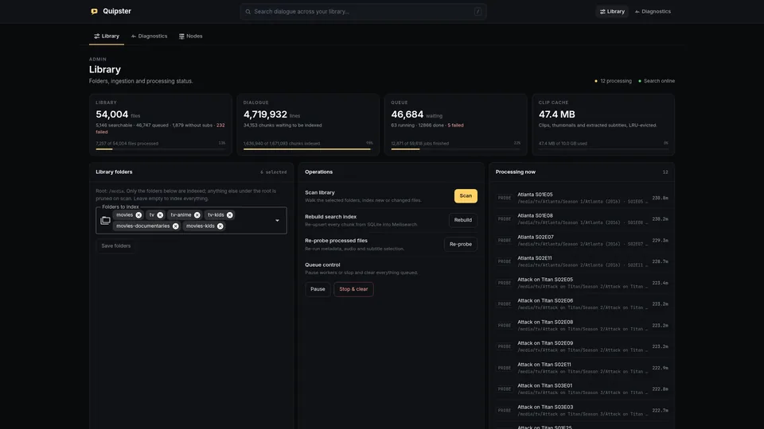](docs/screenshots/admin_library.png)

The ingestion control room. Stat cards track library files, indexed dialogue lines, the job
queue, and clip-cache usage, each with a progress bar. **Library folders** multi-selects which
subfolders under the media root are indexed (empty means the whole root; anything unselected is
pruned on scan). **Operations** offers Scan library, Rebuild search index, and Re-probe processed
files; **Queue control** can pause workers or stop and clear everything queued. **Processing
now** streams live per-file progress, and **Recent jobs** lists every job with status, line
counts, durations, and errors.

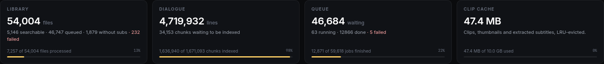

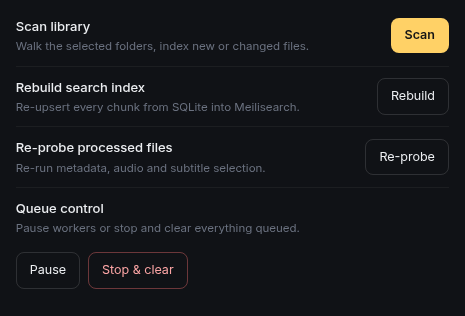

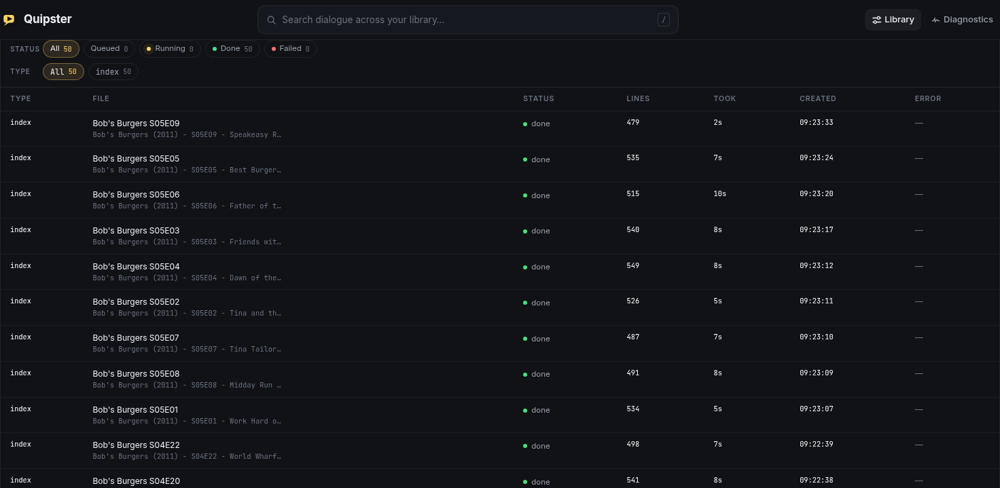

## Admin · Diagnostics

[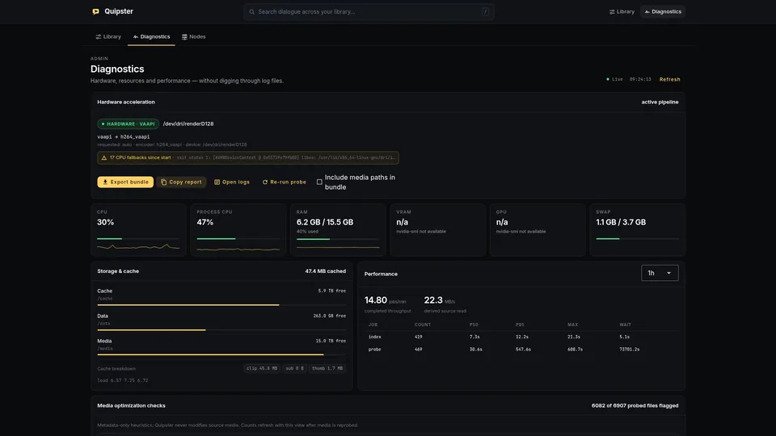](docs/screenshots/admin_diagnostics.png)

A live support console meant to replace `docker compose logs` for first-line triage. The
hardware-acceleration badge names the active pipeline (here VAAPI → `h264_vaapi` on
`/dev/dri/renderD128`) and counts CPU fallbacks when hardware renders fail. Gauges chart CPU,
process CPU, RAM, VRAM, GPU, and swap; **Storage & cache** breaks down cache usage; the
**Performance** panel benchmarks job throughput (jobs/min, MB/s, P50/P95/max per job type over
1h/6h/24h/7d). Media optimization checks flag codec, bitrate, and frame-rate quirks; the
environment section lists FFmpeg/ffprobe versions, codec capabilities, kernel, and runtime;
troubleshooting hints turn repeated failures into actionable advice. One-click **Export bundle**
and **Copy report** hand support everything they need, with secrets redacted.

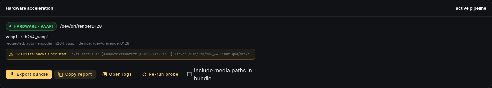

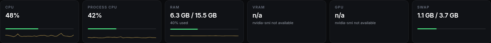

## Admin · Nodes

[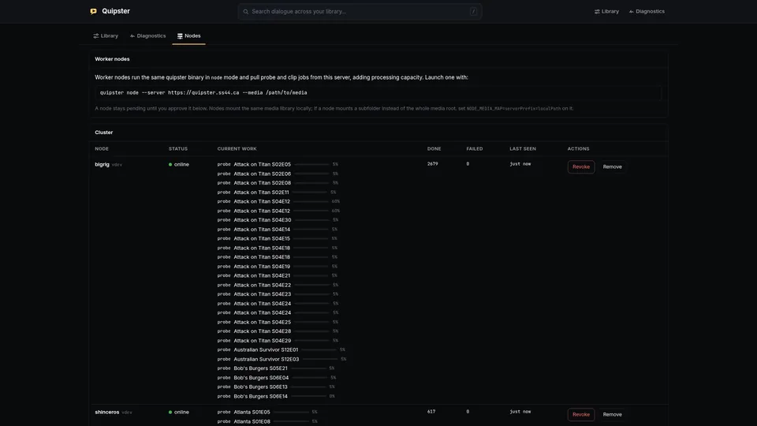](docs/screenshots/admin_nodes.png)

Horizontal scaling for large libraries: the same binary runs
`quipster node --server <main> --media /path/to/media`, registers itself, and stays pending until
you approve it. Approved nodes claim probe and clip jobs over HTTP while the main app keeps
serving search and the UI. The cluster table shows each node's online status, current work with
per-job progress, done/failed counts, last-seen time, and Revoke/Remove actions.

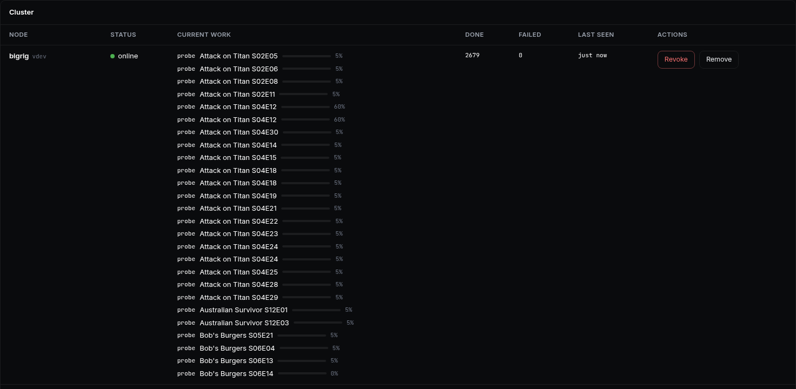
